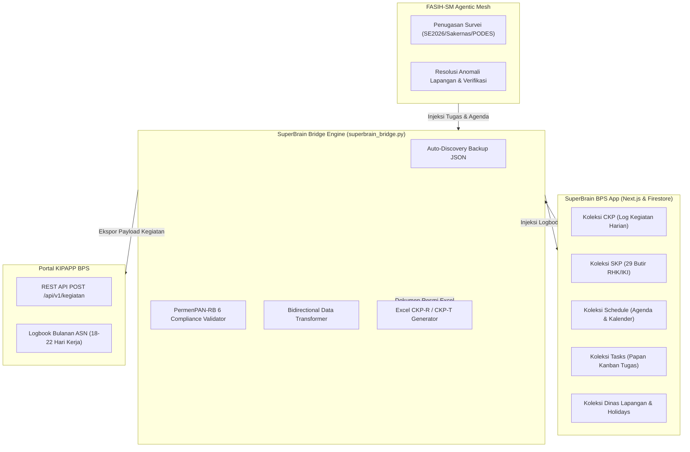

# SuperBrain BPS App Integration Skill

Skill ini mengatur tata kelola, arsitektur integrasi, dan otomasi sinkronisasi antara **SuperBrain BPS** (aplikasi produktivitas dan manajemen kinerja pegawai BPS berbasis Next.js & Google Cloud Firestore) dengan ekosistem **FASIH-SM Agentic Mesh**, portal **KIPAPP BPS**, serta regulasi **PermenPAN-RB No. 6 Tahun 2022**.

---

## 1. Arsitektur Ekosistem SuperBrain BPS

Aplikasi SuperBrain BPS (`D:\superbrain`) berfungsi sebagai pusat pencatatan aktivitas kerja harian, agenda kalender, papan Kanban tugas, dan pemantauan Sasaran Kinerja Pegawai (SKP) bagi aparatur BPS.

---

## 2. Struktur Skema Data & Relasi Entitas

Berkas cadangan SuperBrain (`superbrain-backup-*.json`) mengemas seluruh koleksi data operasional ke dalam satu snapshot JSON terenkapsulasi:

### 2.1. Entitas Utama

| Entitas | Nama Koleksi | Keterangan / Fungsi Utama |
|---|---|---|
| **CKP** | `ckp` | Capaian Kinerja Pegawai harian (`tanggal`, `waktuMulai`, `waktuSelesai`, `durasi`, `rincian`, `kuantitas`, `satuan`, `skpId`, `timKerja`, `buktiDukung`). |
| **SKP** | `skp` | Matriks Sasaran Kinerja Pegawai (24 Utama + 5 Tambahan) berbasis PermenPAN-RB 6 (`id`, `nama`, `kategori`, `tim`, `cluster`, `indikator`). |
| **Schedule** | `schedule` | Agenda rapat, batas waktu penugasan, dan pengingat waktu terhubung Google Calendar (`tanggal`, `waktu`, `judul`, `kategori`, `reminders`). |
| **Tasks** | `tasks` | Papan kerja Kanban dan tahapan checklist pekerjaan (`judul`, `status: todo/in_progress/done`, `peran`, `urgensi`, `deadline`, `checklist`). |
| **Dinas Lapangan** | `perjalanan_dinas` & `dinas_lapangan` | Riwayat perjalanan dinas luar, supervisi lapangan, laporan hasil kegiatan, foto dokumentasi, dan surat tugas BPS. |
| **Holidays** | `holidays` | Hari libur nasional dan cuti bersama resmi pemerintah. |

---

## 3. Aturan Validasi Kepatuhan PermenPAN-RB No. 6 Tahun 2022

Setiap data CKP harian yang diproses oleh SuperBrain Bridge wajib lolos 4 kriteria validasi:

1. **Standar Jam Kerja Efektif & Fleksibilitas DL/Lembur (Sesuai Kondisi Asli):**
   - Jam kerja formal normal kantor BPS adalah minimal 7,5 jam (450 menit) efektif per hari kerja (Senin-Jumat).
   - **Boleh Melebihi Pukul 16:00 / 16:30:** Sesuai kondisi riil di lapangan, jam kerja **DIPERBOLEHKAN MELEBIHI PUKUL 16:00 ATAU 16:30 (misal s.d. 17:00, 17:30, 18:00, atau lebih)**, terutama saat:
     * **Kegiatan Dinas Lapangan (DL):** Wawancara lapangan, supervisi responden, koordinasi desa, dan waktu tempuh perjalanan dinas pulang-pergi dari/ke kecamatan (Sepaku, Sepan, Riko, Sotek, Gersik).
     * **Hari Kerja Biasa di Kantor:** Lembur pengolahan data masif, deadline pelaporan, kalibrasi bot otomasi, atau ekstraksi basis data perizinan.
   - Durasi kerja harian yang melebihi 450 menit (> 7,5 jam) diakui sah dan valid sebagai jam kerja riil diperpanjang (*extended/overtime work*).
2. **Anti-Tumpang Tindih Waktu (*No Overlapping Slots*):**
   - Dalam satu tanggal yang sama, tidak boleh ada dua kegiatan dengan rentang waktu yang bertabrakan (misal: Kegiatan A selesai pukul 10:00, namun Kegiatan B dimulai pukul 09:30).
3. **Keterkaitan RHK & IKI Sah (*SKP Direct Linkage*):**
   - Setiap entri CKP wajib merujuk pada `skpId` yang valid di daftar SKP aktif (1 s.d. 29). Entri tanpa SKP akan ditandai galat `missing_skp_entries`.
4. **Ketersediaan Bukti Dukung Faktual (*Evidence Completeness*):**
   - Setiap entri harus memiliki `buktiDukung` (URL Google Drive / link dokumen) atau lampiran berkas fisik.

---

## 4. Antigravity Agent Actions & Integration

SuperBrain menyediakan bus aksi AI (`ChatActionContext`) dan endpoint REST:
- `CREATE_TASK`, `UPDATE_TASK`, `DELETE_TASK`
- `CREATE_SCHEDULE`, `UPDATE_SCHEDULE`, `DELETE_SCHEDULE`
- `CREATE_CKP`, `UPDATE_CKP`, `DELETE_CKP`
- `CREATE_DINAS_LAPANGAN`
Setiap instruksi dieksekusi real-time ke Firestore dan tersinkronisasi langsung ke UI pengguna.
